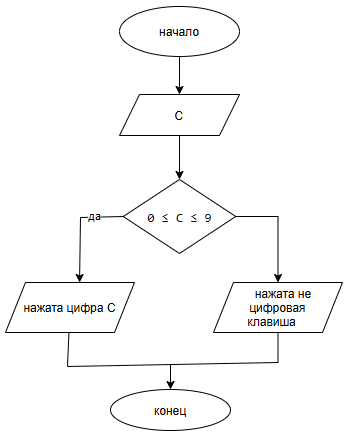

# Лабораторная работа №7 (Вариант 16)
  
Студент: Полякова В.Д.
Группа: бТИИ-261

## Задание

Напишите программу, которая определяет какая цифровая клавиша была
нажата. Для ввода используйте getch(), объявленный в conio.h.

**Требуется:**
1. Составить блок-схему алгоритма решения.
2. Написать программу на языке C.

## Блок-схема

